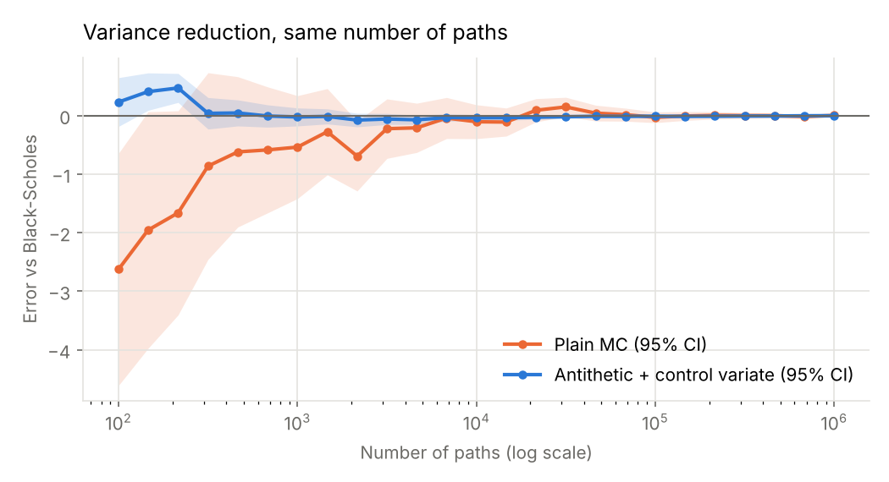
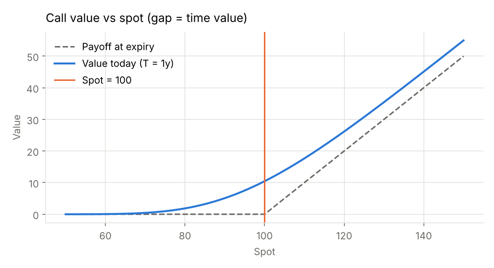
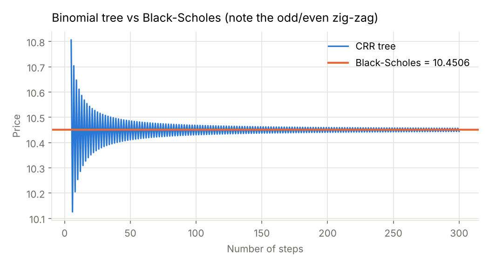
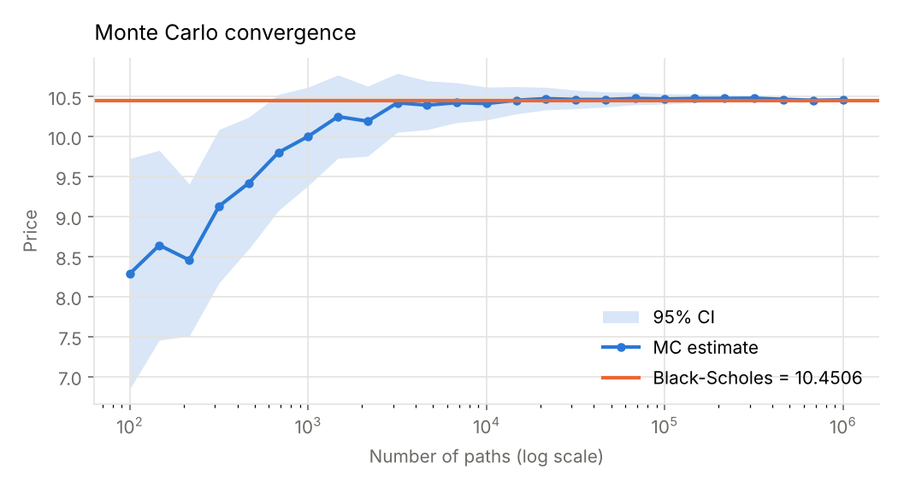
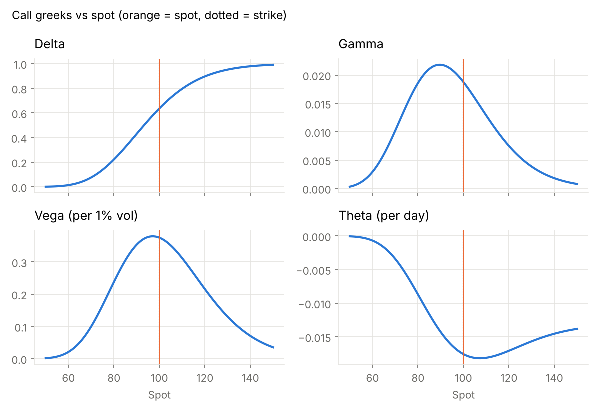

# Option Pricing Engine

[](https://github.com/carlmonnaert/options-pricing-engine/actions/workflows/tests.yml)
[](https://YOUR-APP.streamlit.app)


A small Python library that prices European and American options three independent ways, Black-Scholes, a Cox-Ross-Rubinstein binomial tree and Monte Carlo simulation, and checks that they agree. It comes with a Streamlit dashboard to play with the inputs and watch the methods converge.

**Live demo:** https://YOUR-APP.streamlit.app



*Same number of simulated paths, two estimators. Antithetic variates plus a control variate cut the Monte Carlo variance by about 28x for an at-the-money call.*

## Features

- **Black-Scholes** prices and the five greeks (delta, gamma, vega, theta, rho), with a continuous dividend yield
- **Binomial tree** (CRR), vectorised with numpy, with European or American exercise
- **Monte Carlo** with a standard error and 95% confidence interval, plus two variance reduction techniques: antithetic variates and a control variate
- **Finite-difference greeks** that work with any of the three pricers, used to check the analytic formulas. For Monte Carlo, the bumped prices reuse the same random numbers
- **51 tests** run on every push, on Python 3.10 to 3.12
- **A Streamlit app** with sliders for every input, a greeks comparison table and convergence charts

No market data or API keys needed: every input is a parameter.

## Do the three methods agree?

Prices for a few contracts. The tree uses 1,000 steps; Monte Carlo uses 1,000,000 paths with both variance reduction techniques, shown with its standard error.

| Contract (S, K, T, r, σ, q) | Black-Scholes | Binomial tree | Monte Carlo | American (tree) |
| --- | --- | --- | --- | --- |
| ATM call (100, 100, 1y, 5%, 20%, 0) | 10.4506 | 10.4486 | 10.4484 ± 0.0028 | 10.4486 |
| OTM call (100, 120, 6m, 3%, 30%, 1%) | 2.6970 | 2.6980 | 2.6979 ± 0.0014 | 2.6980 |
| ITM put (100, 120, 1y, 5%, 25%, 0) | 19.1729 | 19.1745 | 19.1727 ± 0.0015 | 21.1753 |
| Short-dated put (50, 55, 3m, 0%, 45%, 0) | 7.6162 | 7.6168 | 7.6156 ± 0.0009 | 7.6168 |

The first row is the textbook example from Hull (10.4506). Two things in the last column are worth noticing:

- The American call is worth exactly the same as the European one. Without dividends, exercising a call early is never optimal.
- The in-the-money put is worth 2.00 more as an American option: exercising early gets you the 120 strike now, and you earn 5% interest on it. In the last row the rate is zero, so there is no interest to earn by exercising early, and the American and European puts are worth the same.

## Quick start

```bash
git clone https://github.com/carlmonnaert/options-pricing-engine.git
cd options-pricing-engine
python -m venv .venv && source .venv/bin/activate
pip install -r requirements.txt

streamlit run app.py   # dashboard at http://localhost:8501
pytest                 # 51 passed
```

Using the library directly:

```python
from optionpricer import bs_price, bs_greeks, binomial_price, mc_price, fd_greeks

bs_price(100, 100, 1.0, 0.05, 0.20, "call")                       # 10.4506
bs_greeks(100, 100, 1.0, 0.05, 0.20, "call").delta                # 0.6368

binomial_price(100, 110, 1.0, 0.08, 0.20, "put", american=True)   # 11.13

res = mc_price(100, 100, 1.0, 0.05, 0.20, "call", n_path=200_000,
               control_variate=True, seed=42)
res.price, res.std_error, res.ci95

# greeks by bump-and-reprice, here on top of Monte Carlo
fd_greeks(100, 100, 1.0, 0.05, 0.20, "call", pricer=mc_price,
          rel_bump=1e-2, n_path=200_000, seed=11).delta
```

Arguments are always `S, K, T, r, sigma, option_type, q`, with rates and volatility as decimals (5% is `0.05`) and `T` in years.

## How it works

### Black-Scholes

The closed-form price of a European call with dividend yield q:

$$C = S e^{-qT} N(d_1) - K e^{-rT} N(d_2), \qquad d_{1,2} = \frac{\ln(S/K) + (r - q \pm \tfrac{1}{2}\sigma^2)T}{\sigma\sqrt{T}}$$

The put follows from put-call parity, $C - P = S e^{-qT} - K e^{-rT}$, which the tests check to $10^{-10}$. N(d₂) is the risk-neutral probability that the call ends in the money.



The gap between today's value and the payoff at expiry is the option's time value.

### Binomial tree

Time to maturity is split into N steps. At each step the stock moves up by $u = e^{\sigma\sqrt{\Delta t}}$ or down by $d = 1/u$, with the risk-neutral probability

$$p = \frac{e^{(r-q)\Delta t} - d}{u - d}$$

Starting from the payoffs at expiry, each node's value is the discounted average of its two children. The whole tree is never stored: one numpy array holds the current time slice, and stepping back is a single vectorised line,

```python
values = disc * (p * values[:-1] + (1 - p) * values[1:])
```

For American options, each node also takes the larger of that value and exercising immediately. A 500-step tree prices in a couple of milliseconds.



The price converges at rate $O(1/N)$ but zig-zags between odd and even N, because the strike falls in a different place relative to the final nodes. Averaging N and N+1 removes most of it, which is what the tests do.

### Monte Carlo

Under geometric Brownian motion the terminal price can be sampled directly, so European options need no time stepping:

$$S_T = S \exp\left(\left(r - q - \tfrac{1}{2}\sigma^2\right)T + \sigma\sqrt{T}\,Z\right), \qquad Z \sim N(0, 1)$$

The price is the discounted average payoff, and the error shrinks like $1/\sqrt{n}$: 100 times more paths for 10 times more precision.



Two variance reduction techniques make it much cheaper to get a precise answer:

- **Antithetic variates.** Each draw Z is paired with −Z. A high outcome and a low outcome are averaged together, so much of the noise cancels.
- **Control variate.** The discounted terminal stock price has a known expectation, $S e^{-qT}$, and moves with the payoff. Each estimate is corrected by $\beta$ times the stock's sampling error, with $\beta = \mathrm{Cov}(X, Y) / \mathrm{Var}(X)$, which removes most of the remaining noise without adding bias.

Standard error for the ATM call with 100,000 paths and the same seed:

| Estimator | Std. error | Variance reduction |
| --- | --- | --- |
| Plain Monte Carlo | 0.0464 | 1x |
| Antithetic variates | 0.0328 | 2.0x |
| Control variate | 0.0177 | 6.9x |
| Both | 0.0088 | 27.8x |

### Greeks

Analytic greeks come from differentiating the Black-Scholes formula. `fd_greeks` computes the same five by bumping each input up and down and repricing (central differences), so it works with any pricer. On the ATM call the two agree to better than 2 parts in a million.

For Monte Carlo the bumped prices must reuse the same random numbers (same seed). Otherwise the noise between two runs is much larger than the price change being measured, and gamma in particular comes out wrong by a factor of several.



## The dashboard

`streamlit run app.py` opens a page with every input in the sidebar: contract, market data, tree steps, number of paths, variance reduction switches and the random seed. It shows the price from each method, the Monte Carlo confidence interval, the early-exercise premium, a table comparing analytic and finite-difference greeks, and the charts above, updated live.

Some things to try:

- Turn off both variance reduction boxes and watch the confidence interval widen about 5x.
- Go from 10,000 to 1,000,000 paths: the standard error drops 10x, not 100x.
- Switch to a put with strike 110 and an 8% rate: the American price is about 2.3 above the European one.
- Add a dividend yield to a call: the early-exercise premium, zero until then, becomes positive.

<!-- Add a screenshot or GIF of the dashboard here: docs/app.png -->

## Tests

```bash
pytest
```

The suite checks properties that must hold for any correct pricer, rather than hand-picked numbers:

- Hull's textbook example and put-call parity for every method
- No-arbitrage bounds (a call is never worth more than the stock, nor less than its intrinsic value)
- Analytic greeks against finite differences, for calls and puts in four market regimes
- The tree converging to Black-Scholes, and its error falling as steps increase
- Monte Carlo within 4 standard errors of Black-Scholes, and each variance reduction technique lowering the standard error
- American puts worth more than European ones, American calls without dividends worth the same
- Invalid inputs rejected with a clear error

GitHub Actions runs them on Python 3.10, 3.11 and 3.12 on every push.

## Project structure

```
optionpricer/
  black_scholes.py   closed-form price, analytic greeks, put-call parity check
  binomial.py        CRR tree, European and American exercise
  monte_carlo.py     simulation with antithetic and control variates
  greeks.py          finite-difference greeks for any pricer
  plots.py           charts used by the app and this README
  _common.py         input validation and payoffs
app.py               Streamlit dashboard
tests/               pytest suite
scripts/
  make_figures.py    regenerates the images in docs/
```

## What's next

- Implied volatility: invert `bs_price` with a root finder and plot the volatility smile from real option chains
- Heston stochastic volatility, priced with the characteristic function and calibrated to the smile
- Longstaff-Schwartz, to price American options by simulation
- Path-dependent payoffs: barrier and Asian options
